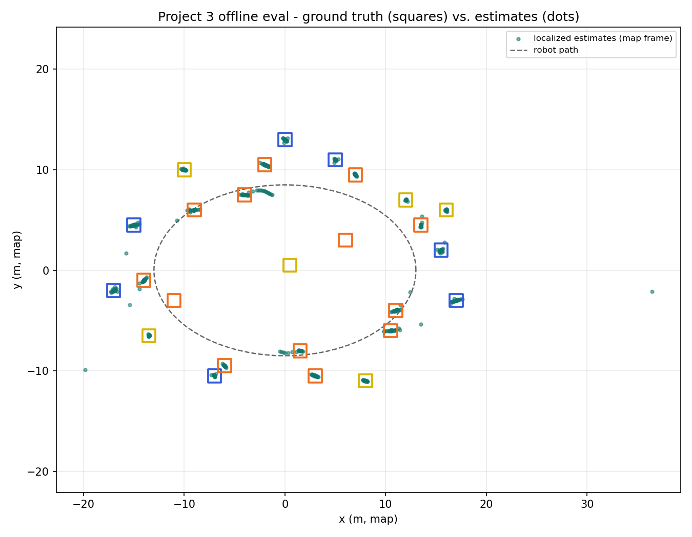
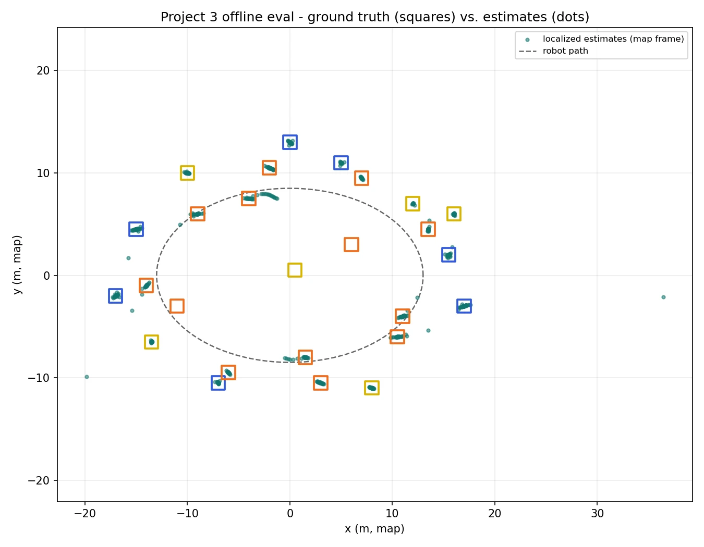
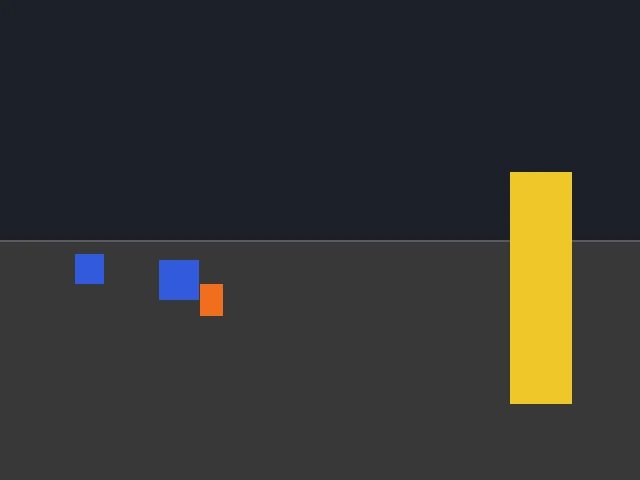

# ROS 2 Mini Perception Stack

A small but complete ROS 2 perception pipeline: a camera publishes
images, a detection node finds objects in them, and a localization node
turns the 2D detections into 3D object positions in the map frame using
TF - visualized in RViz next to ground truth.

```
camera_sim ──/camera/image_raw──▶ detection ──/perception/detections_2d──▶ object_localizer
     │                                                              (monocular depth + TF)
     ├──/camera/camera_info                                                │
     ├──/odom, /tf, /tf_static                              /perception/detections_3d (vision_msgs)
     └──/ground_truth/markers                               /perception/objects_3d (RViz markers)
```

This is Project 3 of a three-part robotics portfolio
([Project 1: detection + tracking](https://github.com/jaelyncuellar/detection-tracking-pipeline),
[Project 2: EKF sensor fusion](https://github.com/jaelyncuellar/ekf-sensor-fusion)),
and doubles as the capstone for a Robotics & Autonomous Systems 101
self-study course.



*Top-down result of the offline evaluation: hollow squares are true
object positions, teal dots are the pipeline's map-frame estimates over
one lap of the robot's path (dashed).*

## What it does

* **`camera_sim_node`** - a stand-in robot + camera. It renders a
  synthetic 3D world (26 traffic cones, crates, and pedestrians around
  an elliptical driving loop) through a pinhole camera model at 10 Hz,
  publishing `sensor_msgs/Image` + `CameraInfo`, driving the loop, and
  broadcasting the TF tree
  `map → odom → base_link → camera_link → camera_optical_frame`
  (REP-103 conventions). It also publishes the true object positions as
  markers for comparison — the perception nodes never read them.
* **`detection_node`** - subscribes to the image topic and publishes
  `vision_msgs/Detection2DArray`. The detector is nearest-palette color
  segmentation (the same `{box, label, score}` detection format the
  Project 1 tracker consumed, so the projects compose). A learned
  detector node could replace it without touching anything downstream.
* **`object_localizer_node`** - subscribes to the detections and the
  `CameraInfo`, estimates each object's 3D position in the optical
  frame with a monocular model (below), looks up
  `map ← camera_optical_frame` in TF at the detection timestamp, and
  publishes `vision_msgs/Detection3DArray` plus an RViz `MarkerArray`.

### The monocular localization model

With no depth sensor, depth comes from the known real height of the
detected class (cones 0.5 m, crates 0.8 m, pedestrians 1.7 m):

```
Z = fy · H_real / box_height_px
```

The object's ground-contact point (bottom-centre of the box) is then
back-projected through the intrinsics to a 3D ray endpoint in the
optical frame. All perception math lives in a ROS-free core module
(`perception_core.py`) shared by the nodes, the offline evaluation, and
the unit tests.

## Verified results

**Live ROS graph** (this stack, launched for real; verification node
subscribed to `/perception/detections_3d` for 30 s -
`out/metrics_live.json`):

| Metric | Value |
|---|---|
| Detection3D messages received | 302 (10 Hz for 30 s) |
| Objects localized | 1,384 |
| Matched to ground truth within 2 m | 1,336 (96.5%) |
| Map-frame position RMSE | **0.31 m** |
| Mean / max error | 0.16 m / 2.00 m |

**Offline evaluation** (same core code, one full 100 s lap, 200 frames -
`out/metrics.txt`):

| Metric | Value |
|---|---|
| Visible object-frames / detections | 840 / 813 |
| Matched / missed / false positives | 797 / 43 / 16 |
| Position RMSE (clean boxes) | **0.25 m** |
| Position RMSE (border-clipped boxes) | 0.40 m |
| Monocular depth mean abs. error | 0.12 m |

5 unit tests cover the projection/localization round-trip, the
base↔map transform inverse, the detector on rendered and blank frames.

## Run it

Requires ROS 2 **Jazzy** on Ubuntu 24.04.

```bash
# Build
mkdir -p ~/ros2_ws/src
cp -r mini_perception_stack ~/ros2_ws/src/
cd ~/ros2_ws
colcon build --packages-select mini_perception_stack
source install/setup.bash

# Headless (default): the whole graph, no GUI
ros2 launch mini_perception_stack perception_stack.launch.py

# With RViz on a desktop (camera view, TF tree, truth vs. estimates)
ros2 launch mini_perception_stack perception_stack.launch.py use_rviz:=true

# Score the live graph (second terminal, same workspace sourced)
python3 scripts/verify_live.py --duration 30

# Offline evaluation + unit tests (no ROS needed)
pip install -r requirements.txt
python3 scripts/run_offline_eval.py
python3 -m unittest discover -s tests -v
```

> **Environment note:** the development VM used for the live numbers
> above blocks UDP loopback, which DDS discovery needs, so the graph
> was run over the Zenoh RMW (`RMW_IMPLEMENTATION=rmw_zenoh_cpp` with
> an `rmw_zenohd` router, TCP). On a normal machine the default FastDDS
> RMW runs the identical launch with no changes.

## Repo structure

```
├── mini_perception_stack/          # the ROS 2 package (ament_python)
│   ├── package.xml, setup.py
│   ├── mini_perception_stack/
│   │   ├── perception_core.py      # ROS-free world sim, renderer,
│   │   │                           # detector, monocular localizer
│   │   ├── camera_sim_node.py      # images, CameraInfo, odom, TF, truth
│   │   ├── detection_node.py       # image -> Detection2DArray
│   │   └── object_localizer_node.py# detections + TF -> Detection3DArray
│   ├── launch/perception_stack.launch.py
│   └── config/perception.rviz
├── scripts/
│   ├── run_offline_eval.py         # full-lap scoring without ROS
│   └── verify_live.py              # scoring against the running graph
├── tests/test_perception_core.py
├── out/                            # metrics + plots from the runs above
└── requirements.txt                # offline only (numpy, pillow, matplotlib)
```

## Design choices

* **ROS-free core, thin nodes.** All algorithms live in plain
  NumPy/Pillow code; nodes are message plumbing. That is what makes the
  full-lap evaluation and unit tests possible without a ROS install,
  and it keeps the door open to re-implementing a node in C++ later
  against the same core behaviour.
* **Standard message types throughout** (`vision_msgs`,
  `visualization_msgs`, `nav_msgs`, TF) - no custom messages, so other
  stacks can consume the outputs directly.
* **The sim is the replaceable part.** On real hardware, a camera
  driver replaces `camera_sim_node` (same two topics) and the robot's
  own localization replaces the scripted TF/odometry; the perception
  nodes do not change.
* **Honest failure accounting.** Border-clipped boxes are scored
  separately, because a truncated box height corrupts the depth
  estimate (0.40 m vs 0.25 m RMSE) - in a production stack these would
  be filtered or handled by a tracker over time.

## Limitations

* Synthetic world and a colour-segmentation detector: this project is
  about the ROS 2 system architecture (topics, TF, launch, RViz),
  message flow, and verified localization accuracy - not about
  state-of-the-art detection. Project 1 covers learned detection
  (YOLO) and tracking.
* Monocular depth assumes known class heights and flat ground; errors
  grow with range and with box-height pixel quantization.
* Localization is per-frame: no tracking or filtering of object
  estimates over time (the natural next step — an EKF per object, as
  in Project 2, would smooth the 0.31 m live RMSE further).
* The RViz config was authored by hand and verified by schema, not
  exported from a desktop RViz session.

## Next steps

* Swap the colour detector for the Project 1 YOLO detector node and
  feed its tracks into the localizer.
* Add a per-object EKF (Project 2) on the map-frame estimates.
* Record a rosbag of the stack and replay it as a regression test.

## Portfolio media

The [case study on jaelyncuellar.com](https://jaelyncuellar.com/projects/ros2-perception-stack) uses web versions of the offline evaluation images in `out/`. Those exact files are kept here so the GitHub and portfolio visuals match:




